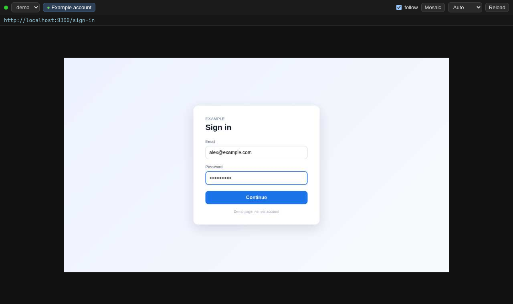
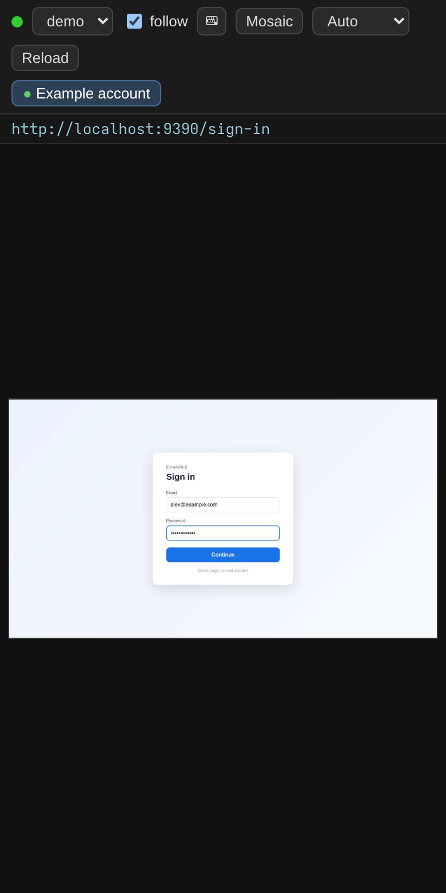

<p align="center">
  
  
  
  
</p>

# browser-viewer

**See the browser your Hermes agent is driving, live, from your phone or laptop, and take the keyboard when it needs you.**

Agents get stuck on logins, 2FA codes and CAPTCHAs. This plugin streams the tabs of the Chromium that Hermes controls to a web page you open from another device. You see what the agent sees, you click, type, scroll and paste yourself, and when you are done the agent carries on in the same logged-in browser.

<p align="center">
  <a href="#install">Install</a> ·
  <a href="#use">Use</a> ·
  <a href="#https">HTTPS</a> ·
  <a href="#security-model">Security</a> ·
  <a href="#disclosure">Disclosure</a> ·
  <a href="#known-limitations">Limitations</a>
</p>

<table>
  <tr>
    <td width="68%"></td>
    <td width="32%"></td>
  </tr>
  <tr>
    <td align="center"><sub>On a laptop</sub></td>
    <td align="center"><sub>On a phone</sub></td>
  </tr>
</table>

## How it works

```
 Hermes agent ──── CDP ───▶  Chromium (managed, persistent profile)
                                  │  JPEG screencast
                                  ▼
 you ── one-time login link ─▶  viewer server ──── WebSocket ───▶  your phone or laptop
                                                                   see, click, type, paste
```

The agent asks for a link, you open it, you log in, and the agent keeps working with the cookies you just created. The streaming server runs as its own detached process, so it outlives the chat session, and it shuts itself down after 60 minutes with no open window.

## What you get

- Several windows and several browsers at once, each browser with its own persistent profile, for example one per account.
- A follow mode: the page follows the tab the agent works on and pins to the tab you are using while you type.
- Stream quality that adapts to each client's round-trip time, or a level you fix yourself.
- Mouse, keyboard (AltGr included), drag and paste, plus touch: a tap clicks, one finger scrolls, and a keyboard button opens the phone keyboard.
- Single-use login links and an `HttpOnly` session cookie. No keystroke, pasted text or secret is written to any log.

## At a glance

| | |
|---|---|
| Hermes | 0.23.1 or newer (developed and tested on v0.23.1) |
| Plugin | 0.1.0, MIT |
| System | Linux, tested on Arch-based Omarchy, x86_64 (process checks read `/proc`) |
| Browser | Chromium or Chrome, tested with Chromium 155 |
| Viewing device | any current browser, touch supported |
| Network | loopback, or a Tailscale address; plain HTTP by default, HTTPS opt-in |

## Install

```bash
hermes plugins install vittoriocompagno/hermes-browser-viewer     # straight from GitHub
hermes plugins install browser-viewer                             # from the Hermes catalog, once it is listed
hermes plugins enable browser-viewer
hermes browser-viewer start                                       # prints a login link: open it on your phone
```

Requirements: Hermes `>=0.23.1`, the Python dependency `aiohttp>=3.9,<4` (installed with the plugin) and a Chromium or Chrome binary on the machine (`chromium`, `google-chrome-stable`, a path in `BV_CHROMIUM`, or one Hermes installed under its `tools/` directory).

## Use

From a terminal:

```bash
hermes browser-viewer start            # starts the server and the browser "login", prints the link
hermes browser-viewer link             # print the link again
hermes browser-viewer new work         # a second browser with its own profile
hermes browser-viewer adopt main http://127.0.0.1:9222   # register a Chromium that is already running (loopback only)
hermes browser-viewer use login        # make browser_exec drive this browser
hermes browser-viewer use --clear      # back to the default clean browser
hermes browser-viewer stop login       # stop a browser (add --purge to also delete its profile)
hermes browser-viewer stop --server    # stop the streaming server
hermes browser-viewer token --rotate   # sign every browser out, then print a fresh login link
hermes browser-viewer tls tailscale    # serve other devices over HTTPS with a Tailscale certificate (see below)
hermes browser-viewer tls files --cert fullchain.pem --key key.pem --name viewer.example.com   # or your own certificate
hermes browser-viewer tls off          # back to plain HTTP; `tls status` shows the current setting
```

From a chat: the `browser_viewer` tool (actions `status`, `start`, `link`, `list`, `new`, `adopt`, `use`, `stop`, `rotate_token`) and the `/viewer` slash command. The agent starts a viewer, gives you the link, and after you have logged in switches `browser_exec` to that browser with `use`.

Open the link from the device you want to control the browser from. It works once and for 10 minutes: use `link` again for another device. The server listens on the addresses you choose with `BROWSER_VIEWER_HOSTS`, by default loopback plus the machine's Tailscale IPv4 if `tailscale` is installed. It never binds `0.0.0.0`. It shuts itself down after 60 minutes with no open window.

### HTTPS

By default the server speaks plain HTTP, which is fine on loopback and on a Tailscale network (WireGuard encrypts it) and nowhere else. HTTPS is opt-in:

- `tls tailscale` asks `tailscale cert` for a Let's Encrypt certificate for this machine's MagicDNS name. It needs MagicDNS and HTTPS Certificates enabled for the tailnet. The plugin refreshes the certificate every time the server starts.
- `tls files` uses a certificate and key you already have, for the host name you pass with `--name`.

The setting takes effect when the server next starts. Every address except loopback is then served over HTTPS (TLS 1.2 or newer) and links use the certificate's host name instead of the IP; loopback stays plain HTTP. The session cookie then carries the `Secure` flag.

## Configuration

| Variable | Meaning | Default |
|---|---|---|
| `BROWSER_VIEWER_HOSTS` | comma-separated specific IPv4 addresses to listen on | `127.0.0.1` plus the Tailscale IPv4 |
| `BV_CHROMIUM` | path to the Chromium or Chrome binary | auto-detected |
| `BV_START_TIMEOUT` | seconds to wait for a new Chromium | `15` |
| `BV_CLOSE_GRACE` | seconds an empty hub keeps its CDP connection | `20` |
| `BV_SESSION_HOURS` | how long a signed-in browser stays signed in | `168` (7 days) |
| `BV_AUTH_RECHECK` | seconds between re-checks of the credential of an open stream | `5` |
| `BROWSER_VIEWER_HOME` | override of the data directory (the plugin sets it for its own server process; useful for tests) | the plugin data dir of the active profile |

State lives in the plugin data directory (`<hermes home>/plugin-data/browser-viewer/`): browser registry, profiles, master secret, pending login tokens, logs.

## Security model

- Whoever holds the link controls a browser that may be logged in to your accounts. Treat the link like a password.
- A link carries a one-time login token (192 random bits, valid 10 minutes). The page sends it with a same-origin `POST /api/session` and receives an `HttpOnly; SameSite=Strict` session cookie (named after the server port, 7 days by default). Merely opening or prefetching the URL does not use the token up, only that POST does; the token is then removed from the address bar. Only its SHA-256 is stored on the server, in a `0700` directory, and consuming it is an atomic file removal, so two simultaneous requests cannot both succeed.
- The cookie is an HMAC-SHA256 signature over its expiry, keyed with a master secret kept in a `0600` file. The master secret never appears in a link, a page or a tool result. Rotating it (`rotate_token`, `token --rotate`) signs every browser out and drops login links that were not used yet, without restarting the server. An open stream is re-checked every few seconds (`BV_AUTH_RECHECK`) and is closed as soon as its cookie has expired or the secret has changed, so a signed-out browser stops receiving frames within seconds. Scripts can present the master secret in the `X-BV-Token` header; it is not accepted in a URL.
- The cookie carries the `Secure` flag on every address served over HTTPS (not on loopback, which stays plain HTTP).
- The WebSocket and the stats endpoint need the cookie (or the master secret). The static page is served without either and contains no secret.
- Managed browsers open their CDP port on `127.0.0.1` only, and a new one is registered only if the debug port is held by the process the plugin just started. Adopted browsers must be loopback endpoints (the plugin can enforce where it connects, not what they listen on), and the plugin never kills a browser it did not start.
- Requests must be addressed to a host name this server serves (its listening addresses, the certificate's name, `localhost`); anything else gets `421`, which defeats DNS rebinding. Login and WebSocket requests that carry an `Origin` must match this server's scheme and host exactly; only clients using the token header may omit it.
- Pages and errors carry `X-Content-Type-Options: nosniff`, `X-Frame-Options: DENY`, `Referrer-Policy: no-referrer` and a Content-Security-Policy that allows only the page's own script and style and forbids framing. There is no HSTS on purpose: it would pin the whole host name, every port.
- Input is accepted only for the tab a client is viewing. Keys, text, mouse clicks and reloads are dropped for 0.8 s after a tab change the user did not ask for; pointer moves and the wheel are not.
- Before killing a managed browser the plugin checks that the registered pid still has the recorded start time and the expected `--user-data-dir`, so a recycled pid is never signalled.
- Purging a profile is limited to directories directly under the plugin's `profiles/`.

## Disclosure

What you should know before installing:

- **Network.** Starts an HTTP/WebSocket server (aiohttp) that listens on the explicit IPv4 addresses above. It speaks plain HTTP unless you enable HTTPS: on a Tailscale network WireGuard encrypts plain HTTP, on any other network it is not encrypted. The plugin makes no outbound network calls of its own and talks to Chromium over `http://127.0.0.1`. The only exception is the opt-in `tls tailscale`, which runs `tailscale cert`: that contacts the Tailscale control plane and Let's Encrypt, and the machine's MagicDNS name appears in public Certificate Transparency logs. The certificate's private key is stored in a `0600` file in the plugin data directory.
- **Credentials.** Managed browsers keep a persistent profile on disk, including cookies and logins, under the plugin data dir. The master secret lives in the same directory. The server and Chromium start with a minimal environment (PATH, HOME, locale, display and proxy variables), not the environment of the Hermes process, so API keys held there are not inherited.
- **Shell commands.** Launches Chromium (`--remote-debugging-port` on loopback, `--user-data-dir=<profile>`), runs `chromium --version` to pick a binary at least as recent as the one that created a profile, runs `tailscale ip -4` to find the Tailscale address, `tailscale status --json` and `tailscale cert` when HTTPS is enabled with `tls tailscale`, and runs `hermes config set|unset browser.cdp_url` when you use `use` or `stop`.
- **Global setting.** `use` writes `browser.cdp_url`, which makes every Hermes session of that profile (other chats, cron jobs) drive that browser until cleared, and `browser_exec` then acts with every login that browser holds. That is the point of `use`, and the tool description says it must only be called when the user asks. `stop` clears the setting first and stops the browser only if that worked. `hermes config` runs without an extra approval step, as a direct consequence of the action you asked for.
- **Background processes.** The streaming server is a detached process that outlives Hermes sessions and exits by itself after the idle timeout. Managed Chromium processes keep running until stopped.
- **Reads outside its own data.** `/proc/<pid>` for process identity, and the Chromium builds Hermes installed under `<hermes home>/tools/`.
- **Local CDP access.** Any CDP client on the same machine, Hermes included, can read what is in a page, password fields included. This plugin does not add that exposure, but it is why you should keep the host single-user.
- **Links in the tool result.** `start` and `link` return login links. They work once and expire after 10 minutes, so a transcript does not hold anything reusable once a link has been used or has expired.
- **Plain HTTP unless you enable HTTPS.** Without `tls`, the session cookie has no `Secure` flag and neither it nor the stream is encrypted on the wire. On a Tailscale network WireGuard encrypts everything; on any other network enable `tls` or do not expose the port.
- **What the agent sees.** `status` and `list` return, for each tab of the registered browsers, its origin (scheme and host, never path or query) and a title cut to 60 characters. They land in the session transcript.
- **Chromium's own traffic.** The browser is a regular, unmodified Chromium. Besides what the opened pages need it makes the background connections Chromium normally makes (the logs show, for example, Google's push messaging). The plugin neither adds nor hides any of it.
- **Telemetry.** None from the plugin.

## Known limitations

- HTTPS is opt-in, and the certificate is only refreshed when the server starts: a server kept running past the certificate's expiry keeps serving the old one (it exits after 60 idle minutes by default). If Tailscale cannot be reached at start, the certificate on disk is reused with a warning as long as it has not expired; the server never falls back to plain HTTP on a TLS address.
- No per-device session list: a session lasts until it expires or the master secret is rotated, and rotating signs every browser out.
- Frame rate and bandwidth were measured on loopback with simulated delay, not on real WAN links.
- On a phone in portrait the remote page (1280 px wide) is scaled to about a third, so fields are small. Landscape is much more comfortable.
- The tool handler is synchronous: a cold start can block for up to about 75 seconds (15 s for Chromium plus up to 60 s for the server), more if `hermes config` is slow (30 s) or `tls tailscale` has to ask Tailscale for a certificate (up to 130 s).
- Cookies are not scoped by port: on the same host name another service on a different port receives the viewer's cookie. Its name carries the port and the value is signed and `HttpOnly`, so it is useless to that service, but it is sent.
- After the 0.8 s quiet window, keystrokes go to the tab the agent opened. A click is not required first.
- With two windows on different tabs of a browser that has a real window (not headless), tab activation for streaming can alternate; headless browsers are not affected. Tab activations done by the agent itself are not tracked.
- `tls` keys must not be passphrase-protected, and on Linux `tailscale cert` needs root or your user set as Tailscale operator (`tailscale set --operator=$USER`, once, as root).
- Not tested on Windows clients with non-US keyboard layouts beyond AltGr handling.

## Development

```bash
python3 -m unittest -v tests.test_viewer      # needs aiohttp
hermes plugins validate . --install-deps      # the catalog gate
```

## License

MIT, see `LICENSE`.
